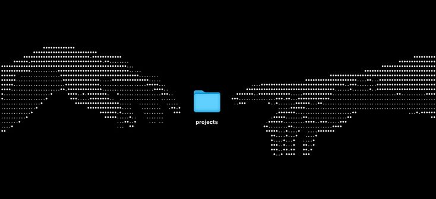

  

### about

12y backend developer. I build web servers and APIs with **Go** and **Echo**, store data in **PostgreSQL**, and make things look good with **HTML** and **CSS**. I ship my code with **Git**, and I'm learning something new every day.

---

### core skills

  

- **languages:** Go · SQL · HTML · CSS
- **backend:** Echo (Go web framework)
- **databases:** PostgreSQL
- **tools:** Git · GitHub

---

### featured projects

<!--
  EDIT THIS SECTION: replace the placeholders below with your real projects.
  Copy the block to add more projects.
-->

#### [Api-rest-go](https://github.com/PedroPagottoDev/api-tarefas-go)

*Go · Echo · PostgreSQL*

One sentence about what this project does.

- What it does or what you learned building it
- Another cool detail
- Another cool detail

---

### currently learning

- building better APIs with Go + Echo
- writing cleaner SQL queries in PostgreSQL
- making nicer layouts with CSS
- keeping my Git history organized

---

made with ♥ and a lot of `go run`
